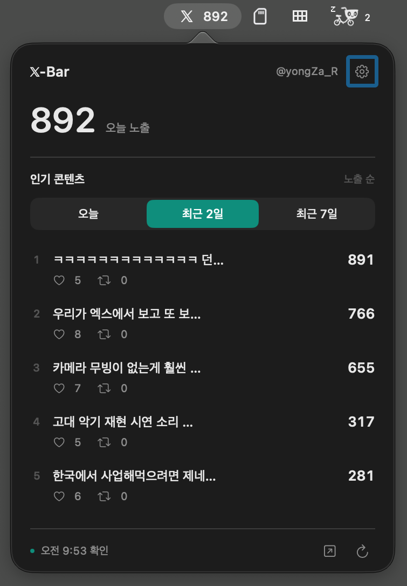

# 𝕏-Bar

| Mac | Windows |
| --- | --- |
| **[Mac 다운로드 · Download](https://github.com/yooongZa/xbar/releases/download/v0.5.4/X-Bar-0.5.4-macOS-universal.dmg)** | **[Windows 다운로드 · Download](https://github.com/yooongZa/xbar/releases/download/windows-v0.4.3-beta.1/XBar-0.4.3.0-windows-x64-setup.exe)** |
| 0.5.4 · macOS 14+ · Apple Silicon / Intel | 0.4.3 beta.1 · Windows 11 x64 |
| DMG · Signed & notarized | EXE · Unsigned installer |
| [설치 안내 · Install](https://yooongza.github.io/xbar/#install) | [설치 안내 · Install](windows/README.md) |

**[한국어](README.ko.md) · [English](README.en.md) · [日本語](README.ja.md)**

Your X posts, at a glance in the Mac menu bar or on your Windows desktop.

| 언어 / Language / 言語 | 홈페이지 / Website / Webサイト |
| --- | --- |
| 한국어 | [Mac·Windows 다운로드 안내](https://yooongza.github.io/xbar/) |
| English | [Mac and Windows downloads](https://yooongza.github.io/xbar/en.html) |
| 日本語 | [Mac・Windowsのダウンロード案内](https://yooongza.github.io/xbar/ja.html) |

**[𝕏 Follow the creator · 제작자 팔로우 · 開発者をフォロー → @yongZa_R](https://x.com/yongZa_R)**

Free · macOS 14+ / Windows 11 x64 · 한국어 / English / 日本語

Windows is currently a beta with an unsigned installer. SmartScreen may warn, or device policy may block it. See the [Windows installation guide](windows/README.md).

## Start here / 시작하기 / はじめに

**Mac:** Open the DMG and drag X-Bar into Applications. **Windows:** Run the EXE installer. Then connect your X account in the app; Mac also supports Safari connection. No GitHub account is needed. Your X account must have access to X Analytics.

**Mac:** DMG를 열어 X-Bar를 응용 프로그램에 넣으세요. **Windows:** EXE 설치 파일을 실행하세요. 앱에서 X 계정을 연결하면 됩니다. Mac에서는 Safari 연결도 지원합니다. GitHub 가입은 필요 없으며, X 분석 화면에 접근할 수 있는 계정이 필요합니다.

**Mac:** DMGを開き、X-Barをアプリケーションフォルダへ移動してください。**Windows:** EXEインストーラーを実行してください。アプリ内でXアカウントを接続できます。MacではSafari接続にも対応しています。GitHubへの登録は不要です。Xアナリティクスを利用できるアカウントが必要です。

## About the numbers / 수치 안내 / 数値について

X-Bar displays values read from X Analytics. Delayed updates or inconsistencies in X Analytics can also appear in the widget, so its figures may differ from other X screens. Compare values using the same date range in X Analytics.

X-Bar는 X 분석 화면의 수치를 읽어 표시합니다. X 분석의 갱신 지연이나 수치 불일치가 위젯에도 반영될 수 있어, 다른 X 화면의 숫자와 차이가 날 수 있습니다. 비교할 때는 X 분석에서 같은 기간을 선택해 확인해 주세요.

X-BarはXアナリティクスに表示される数値を読み取ります。Xアナリティクスの更新遅延や数値の不一致がウィジェットにも反映され、他のX画面と数値が異なる場合があります。比較する際は、Xアナリティクスで同じ期間を選択してください。

## Source / 소스 코드 / ソースコード

- [한국어 안내·빌드 방법](README.ko.md)
- [English guide & build instructions](README.en.md)
- [日本語ガイド・ビルド方法](README.ja.md)
- [App source](app/) · [Release history](https://github.com/yooongZa/xbar/releases) · [Security](SECURITY.md)
- [짧은 릴리즈 히스토리 / Release history](HISTORY.md)
- [Update behavior & release preparation / 업데이트 동작·배포 절차](docs/UPDATES.md)
- [Windows 11 desktop widget / Windows 바탕화면 위젯](windows/README.md)
- [Code signing policy / 코드 서명 정책](windows/CODE-SIGNING-POLICY.md) · [Windows privacy / 개인정보 안내](windows/PRIVACY.md)

## License / 라이선스 / ライセンス

Copyright © 2026 LIMOD · roh yongwook. Project code is licensed under **[GPL-3.0-only](LICENSE)**. Distributed derivatives must comply with GPLv3, including its corresponding-source requirements. The license does not grant rights to X’s service, trademarks, or third-party content shown in screenshots. X-Bar is an independent project and is not affiliated with X.
